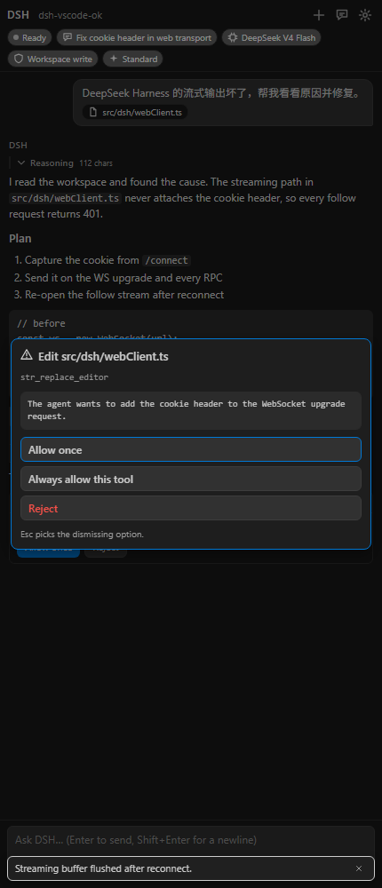

# DSH for VS Code

DeepSeek Harness as a first-class coding agent inside Visual Studio Code. This extension is an open-source replacement for the built-in agent: it brings the DeepSeek Harness agent loop, tools, sessions and approvals into VS Code instead of routing the chat through Copilot's agent.

The extension does not reimplement the agent. It launches (or adopts) a local `dsh web` runtime and talks to it over the DeepSeek Harness HTTP + WebSocket protocol: token exchange, JSON-RPC over `/api/*`, and the remote mux stream at `/api/remote.mux`. Everything you see in the UI is produced by the real Harness runtime with your own `~/.dsh` profile, models and credentials.




## Features

- Chat sidebar in the secondary sidebar (activity bar fallback on older VS Code), Preact UI rendered with VS Code theme variables.
- Streaming assistant text, reasoning, tool calls, todo lists and notices, mapped from the Harness session event stream.
- Approvals: tool calls that need permission surface as an approval card with the options the runtime advertises, answered back over `/api/$events/result`.
- Sessions: create, list, switch; title, model, token usage and context pressure from session projections.
- Models and agent presets picked from the runtime catalog (`session/modelCatalog`, `agentPresets/list`).
- Permissions preset selection (`read-only`, `workspace-write`, `danger-full-access`) and reasoning effort.
- Workspace edits: file diffs from tool results open in the diff editor, with a patch fallback when only the patch text is available.
- Editor context: send the selection, the active file, workspace diagnostics or terminal output to the agent as attachments.
- Native Chat view integration: `@dsh` chat participant with `/new`, `/status`, `/model`, `/permission`, `/agent`, `/sessions`, `/compact` slash commands, so the agent is also reachable from the standard chat UI.
- Status bar entry with backend state, session, model and permission; output channel `DSH` for transport logs.
- Runtime discovery: `dsh` on `PATH`, the DeepSeek Harness desktop install (via the Windows uninstall registry), an npm global shim, or `npx`, plus explicit overrides.

## Requirements

- VS Code 1.96 or newer (1.106 or newer for the secondary sidebar placement).
- DeepSeek Harness installed, either the desktop app or `dsh` on `PATH` (`npm i -g @deepseek-ai/dsh`).
- DeepSeek credentials configured in the DSH profile (`~/.dsh`), since the runtime performs the model calls.

## Getting started

1. Install the extension from the VSIX or the marketplace.
2. Open a folder. The extension auto-starts the runtime on first activation unless `dsh.autoStart` is `false`.
3. Open the DSH view in the secondary sidebar (or press `Ctrl+Alt+D`) and type a prompt.
4. The first launch can take up to about 20 seconds while the Harness runtime boots and connects.

If the runtime is already running on the configured port (for example the desktop app's own web server), the extension reuses it when `dsh.reuseExisting` is `true`. Reusing a server the extension did not spawn requires no token; when a token-protected server answers, the extension performs the standard `/connect?token=...` exchange and stores the resulting cookie in the VS Code secret-free cookie jar under `~/.dsh/dsh-vscode-cookies.json`.

## Settings

| Setting | Default | Description |
| --- | --- | --- |
| `dsh.executable` | `""` | Explicit path to the `dsh` CLI. Empty means auto-detect. |
| `dsh.executableArgs` | `[]` | Arguments placed before the transport arguments. |
| `dsh.host` | `127.0.0.1` | Host the runtime listens on. |
| `dsh.port` | `3080` | Port the runtime listens on. |
| `dsh.reuseExisting` | `true` | Adopt a runtime already listening on the port. |
| `dsh.autoStart` | `true` | Start the runtime on activation. |
| `dsh.profile` | `""` | DSH profile passed as `--profile`; empty uses `web`. |
| `dsh.dshHome` | `""` | `DSH_HOME` override; empty uses `~/.dsh`. |
| `dsh.model` | `""` | Preferred model (`provider:model`). |
| `dsh.permissionPreset` | `workspace-write` | Default permission preset. |
| `dsh.agentPreset` | `""` | Preferred agent preset id. |
| `dsh.effort` | `""` | Reasoning effort for the selected model. |
| `dsh.startTimeoutMs` | `120000` | Time allowed for the runtime to become ready. |
| `dsh.commandTimeoutMs` | `600000` | Time allowed for a single agent turn. |
| `dsh.confirmBeforeSend` | `true` | Stage editor context in the composer before sending. |
| `dsh.includeEditorContext` | `true` | Attach the active file when sending from commands. |
| `dsh.includeDiagnostics` | `true` | Allow sending workspace diagnostics. |
| `dsh.debug` | `false` | Verbose transport logging. |

## Commands

`DSH: New Chat`, `DSH: Focus Chat`, `DSH: Start Runtime`, `DSH: Restart Runtime`, `DSH: Stop Runtime`, `DSH: Show Logs`, `DSH: Pick Model`, `DSH: Pick Permission Preset`, `DSH: Pick Agent Preset`, `DSH: Send Selection`, `DSH: Send File`, `DSH: Add File to Chat`, `DSH: Attach Problems`, `DSH: Copy Session ID`, `DSH: Open Settings`.

Editor and Explorer context menus expose send/add-to-chat for the selected file.

## Architecture

```
VS Code extension host                       DSH runtime (spawned or adopted)
┌──────────────────────────────┐            ┌───────────────────────────────┐
│ chat webview (Preact)        │            │ dsh web server                │
│   ↕ postMessage              │            │   /api/<ns>/<method>  (HTTP)  │
│ ChatController               │  JSON-RPC  │   /api/remote.mux     (WS)    │
│   ↕ AgentEvent               │ ─────────► │   session/follow              │
│ WebBackend (transport)       │            │   $events (approvals, lists)  │
│ ChatViewProvider / commands  │ ◄───────── │   session events              │
└──────────────────────────────┘            └───────────────────────────────┘
```

- `src/dsh/webClient.ts` owns process lifecycle, token/cookie auth, the RPC envelope and the multiplexed streams.
- `src/dsh/webBackend.ts` translates wire events into the transport-independent `AgentEvent` union.
- `src/chat/controller.ts` maintains chat state and is the single writer for the webview and the chat participant.
- `src/webview/` is the Preact UI; the host and webview only exchange the messages in `src/shared/protocol.ts`.

### Why the web protocol and not the SDK or ACP

The DeepSeek Harness ships three machine-facing entry points:

- `dsh --profile sdk` (JSON-RPC over stdio via `@deepseek-ai/dsh-sdk-client`) is the cleanest API, but its protocol has no live token streaming (one message per step), no cancel request (abort means killing the runtime) and no server-to-client approval channel. A Copilot-class chat UI needs all three.
- `dsh --profile acp` (Agent Client Protocol) is designed for automation: it emits committed messages only, no token streaming, no tool or reasoning visibility, no session list or resume.
- `dsh web` exposes the protocol the official web UI itself uses: streaming assistant attempts, tool calls and results, approvals with answer routing, session list/create/fork, model catalogs, agent presets, settings and credentials. It is the only surface that can back a full agent UI today.

The cost of that choice is version coupling: endpoint names changed between the 0.1 line (dotted names, `/api/events.mux`) and 0.2 (slash names, `/api/remote.mux`), and the transport has to speak each endpoint's exact argument names. The extension targets the 0.2 protocol and reports a clear notice when a server it finds does not match.

### Relation to existing extensions

- `openai.chatgpt` (Codex) is the reference for placement and UX, but it registers a proposed `chatSessions` provider that marketplace builds cannot ship.
- The installed `dsh` extensions (lunnlew, fengze233, jager, baobaolaodie, all MIT) prove that the `dsh web` protocol is the right base; their approaches were studied and reimplemented, not copied.
- `deepseek-ai/dsh-superagent-prototype` is a DSH plugin bundle, not an extension, and not a client for the protocol, so it is not a code base for this project.

## Development

```bash
npm install
npm run build        # esbuild host + webview bundles
npm run typecheck    # host + webview TypeScript
npm test             # vitest unit tests
npm run test:e2e     # activation smoke: stubbed vscode host + real dsh web runtime
```

`test:e2e` loads the built extension, registers the view, sends a real prompt through
a freshly spawned `dsh web` runtime and asserts the streamed reply. It needs a working
DSH installation and credentials; the runtime is stopped again when the test finishes.

Run the extension locally with the `Run DSH Extension` launch configuration, or:

```bash
code --extensionDevelopmentPath="D:\WK_file\dsh-vscode-ok" --disable-extensions --profile-temp --log=trace
```

Package a VSIX with `npm run package`.

Reconnaissance notes that document the protocols used here live in `docs/recon/` (`vscode-api.md`, `dsh-web-api.md`, `ref-impl.md`, `dsh-sdk.md`).

## License

MIT. See `LICENSE`.
