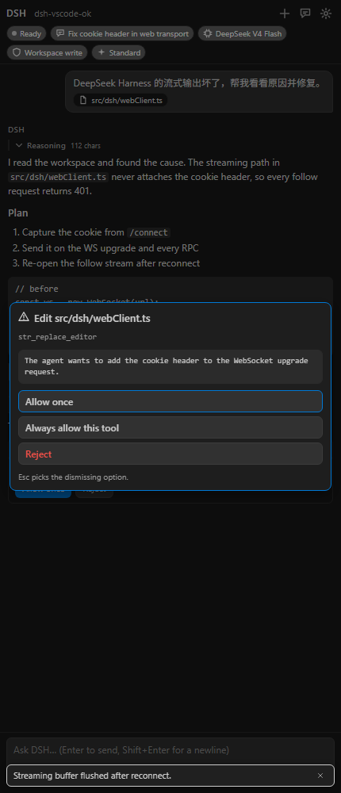

# dsh-vscode-ok

[English](README.md)

`dsh-vscode-ok` 是一个独立、开源的 Visual Studio Code 编码代理扩展。它驱动开源的 DSH（DeepSeek Harness）运行时，把流式聊天代理放进侧边栏：工具调用、工作区修改、审批、会话、模型与权限预设都在里面。聊天走 DSH 运行时，不经过 Copilot 的代理。

本项目与 DeepSeek 没有隶属、背书或赞助关系。"DeepSeek"、"DeepSeek Harness"、"DSH" 仅用于说明与哪个运行时兼容，相关名称与商标归其所有者。扩展内不含 DeepSeek 的 logo 或品牌素材。

扩展不重新实现代理，而是启动本地 `dsh web` 运行时，通过观察得到的 HTTP 与 WebSocket 协议与它通信：token 交换、`/api/*` 上的 JSON-RPC、以及 `/api/remote.mux` 多路复用流。界面里的一切都来自真实运行时，使用你自己的 `~/.dsh` 配置、模型与凭据。



## 功能

- 侧边栏聊天面板，放在次级侧边栏；旧版 VS Code 自动回退到活动栏。界面用 Preact 编写，配色全部取自 VS Code 主题变量。
- 流式输出助手文本、推理、工具调用、待办列表与提示信息，映射自运行时的会话事件流。
- 审批：需要授权的工具调用会弹出审批卡片，选项由运行时给出，回答通过 `/api/$events/result` 回传。
- 会话：新建、列出、切换；标题、模型、token 用量与上下文压力取自会话投影。
- 模型与 agent 预设从运行时目录读取（`session/modelCatalog`、`agentPresets/list`）。
- 权限预设（`read-only`、`workspace-write`、`danger-full-access`）与推理强度可选。
- 工作区修改：工具结果里的文件差异直接在差异编辑器中打开，只有 patch 文本时回退为差异文档。
- 编辑器上下文：可以把选区、当前文件、工作区诊断或终端输出作为附件发给代理。
- 原生 Chat 视图集成：`@dsh` chat participant，支持 `/new`、`/status`、`/model`、`/permission`、`/agent`、`/sessions`、`/compact` 斜杠命令，标准聊天界面里也能用。
- 状态栏显示后端、会话、模型与权限；输出通道 `dsh-vscode-ok` 记录传输日志。
- 运行时自动发现：`PATH` 上的 `dsh`、桌面安装（读 Windows 卸载注册表）、npm 全局 shim，或 `npx`，也可以手动指定路径。

## 环境要求

- VS Code 1.96 或更新；次级侧边栏需要 1.106 或更新。
- 本机安装过 DSH 运行时，桌面应用或 `PATH` 上的 `dsh` 均可（`npm i -g @deepseek-ai/dsh`）。
- DSH 配置目录（`~/.dsh`）里已配置模型凭据，因为模型调用由运行时发起。

## 快速开始

1. 从 VSIX 安装扩展。
2. 打开一个文件夹。除非 `dsh.autoStart` 设为 `false`，扩展在首次激活时自动启动运行时。
3. 点开次级侧边栏里的 dsh-vscode-ok 视图，或按 `Ctrl+Alt+D`，输入提示词。
4. 首次启动需要几秒钟，运行时启动并连接完成后即可对话。

扩展只驱动自己启动的运行时：启动 token 只打印在子进程 stdout 上，别处拿不到，所以桌面应用或别的扩展启动的服务无法被接管。配置端口已被占用且 `dsh.reuseExisting` 为 `true` 时，扩展改用一个空闲端口启动，而不是直接报错。启动 token 通过 `/connect?token=...` 换成 peer cookie，cookie 只保存在本次会话内存中。

## 设置

| 设置项 | 默认值 | 说明 |
| --- | --- | --- |
| `dsh.executable` | `""` | `dsh` 命令的完整路径；留空表示自动发现。 |
| `dsh.executableArgs` | `[]` | 放在传输参数之前的额外参数。 |
| `dsh.host` | `127.0.0.1` | 运行时监听地址。 |
| `dsh.port` | `3080` | 运行时监听端口。 |
| `dsh.reuseExisting` | `true` | 端口被占用时改用空闲端口。 |
| `dsh.autoStart` | `true` | 激活时自动启动运行时。 |
| `dsh.profile` | `""` | 传给 `--profile` 的 DSH profile；留空使用 `web`。 |
| `dsh.dshHome` | `""` | 覆盖 `DSH_HOME`；留空使用 `~/.dsh`。 |
| `dsh.model` | `""` | 首选模型，格式 `provider:model`。 |
| `dsh.permissionPreset` | `workspace-write` | 默认权限预设。 |
| `dsh.agentPreset` | `""` | 首选 agent 预设 id。 |
| `dsh.effort` | `""` | 当前模型的推理强度。 |
| `dsh.startTimeoutMs` | `120000` | 等待运行时就绪的时限。 |
| `dsh.commandTimeoutMs` | `600000` | 单轮对话的时限。 |
| `dsh.confirmBeforeSend` | `true` | 先把编辑器上下文放进输入框，再发送。 |
| `dsh.includeEditorContext` | `true` | 从命令发送时附带当前文件。 |
| `dsh.includeDiagnostics` | `true` | 允许发送工作区诊断。 |
| `dsh.debug` | `false` | 输出详细传输日志。 |

## 命令

`dsh-vscode-ok: New Chat`、`dsh-vscode-ok: Focus Chat`、`dsh-vscode-ok: Start Backend`、`dsh-vscode-ok: Restart Backend`、`dsh-vscode-ok: Stop Backend`、`dsh-vscode-ok: Show Logs`、`dsh-vscode-ok: Pick Model`、`dsh-vscode-ok: Pick Permission Preset`、`dsh-vscode-ok: Pick Agent Preset`、`dsh-vscode-ok: Send Selection`、`dsh-vscode-ok: Send File`、`dsh-vscode-ok: Add File to Chat`、`dsh-vscode-ok: Attach Problems`、`dsh-vscode-ok: Copy Session ID`、`dsh-vscode-ok: Open Settings`。

编辑器与资源管理器的右键菜单里有发送选区、发送文件、加入聊天。

## 架构

```
VS Code 扩展宿主                          DSH 运行时（由扩展启动）
┌──────────────────────────────┐        ┌───────────────────────────────┐
│ chat webview（Preact）        │        │ dsh web 服务                   │
│   ↕ postMessage              │        │   /api/<ns>/<method>  (HTTP)  │
│ ChatController               │ JSON-  │   /api/remote.mux     (WS)    │
│   ↕ AgentEvent               │ RPC    │   session/follow              │
│ WebBackend（传输层）          │ ─────► │   $events（审批、列表等）      │
│ ChatViewProvider / 命令       │ ◄───── │   会话事件                     │
└──────────────────────────────┘        └───────────────────────────────┘
```

- `src/dsh/webClient.ts` 负责进程生命周期、token 与 cookie 认证、RPC 信封与多路复用流。
- `src/dsh/webBackend.ts` 把线上事件转换成与传输无关的 `AgentEvent` 联合类型。
- `src/chat/controller.ts` 维护聊天状态，是 webview 与 chat participant 的唯一写入方。
- `src/webview/` 是 Preact 界面；宿主与 webview 之间只交换 `src/shared/protocol.ts` 定义的消息。

### 为什么用 web 协议，而不用 SDK 或 ACP

DSH 运行时对外提供三个机器接口：

- `dsh --profile sdk`（stdio 上的 JSON-RPC，客户端包 `@deepseek-ai/dsh-sdk-client`）是最干净的 API，但公开协议没有逐 token 流式输出，每步只给一条完整消息；没有取消请求，中止意味着杀掉运行时；已发布的包里也没有服务端到客户端的审批通道。本类聊天界面这三项都需要。
- `dsh --profile acp`（Agent Client Protocol）面向自动化：只发已提交的消息，没有逐 token 流式，看不到工具与推理过程，也没有会话列表与恢复。
- `dsh web` 暴露的是官方 web 界面自己在用的协议：流式 assistant 尝试、工具调用与结果、带回答路由的审批、会话的新建与列表与分叉、模型目录、agent 预设、设置与凭据。

代价是与版本强耦合：0.1 行用点号端点与 `/api/events.mux`，0.2 行改成斜杠端点与 `/api/remote.mux`，每个端点还要参数名完全一致。本项目针对 0.2 协议，发现服务端不匹配时会给出明确提示。

### 与现有扩展的关系

- Codex 扩展在侧边栏位置与聊天布局上值得参考，但它注册的是 propos 的 `chatSessions` provider，市场构建无法发布；本扩展改用稳定的 chat participant API 加 webview 视图。
- 其他 MIT 许可的 DSH 扩展在启动、认证与流式行为上被研究过，没有复制它们的源码或资源；这里的协议事实是通过观察运行时的真实流量重新得出的。
- `deepseek-ai/dsh-superagent-prototype` 是 DSH 插件包，不是 VS Code 扩展，也不是本协议的客户端，因此不作为本项目的代码基。

## 开发

```bash
npm install
npm run build        # 用 esbuild 打包宿主与 webview
npm run typecheck    # 检查宿主与 webview 的 TypeScript
npm test             # 运行 vitest 单元测试
npm run test:e2e     # 激活冒烟：桩 vscode 宿主 + 真实 dsh web 运行时
```

`test:e2e` 会加载构建后的扩展、注册视图，通过新启动的 `dsh web` 运行时发送一条真实提示词并断言流式回答。它需要可用的 DSH 安装与凭据，测试结束时会停掉运行时。

本地调试可以用 `Run dsh-vscode-ok Extension` 启动配置，或者：

```bash
code --extensionDevelopmentPath="D:\WK_file\dsh-vscode-ok" --disable-extensions --profile-temp --log=trace
```

用 `npm run package` 打包 VSIX。

协议调研笔记在 `docs/recon/`（`vscode-api.md`、`dsh-web-api.md`、`ref-impl.md`、`dsh-sdk.md`），属于研究记录，不随扩展打包。

## 排查常见问题

- 视图里提示找不到 runtime：确认桌面应用已安装，或在设置里把 `dsh.executable` 指向 `dsh.cmd` 的完整路径。
- 端口冲突：`dsh.reuseExisting` 为 `true` 时会自动换端口；日志里会写 `starting the runtime on <port>`。
- 想看到协议细节：打开输出通道 `dsh-vscode-ok`，并把 `dsh.debug` 设为 `true`。
- 没有模型可选：运行时没读到凭据，检查 `~/.dsh` 里的模型配置。

## 命名、许可与声明

- 项目名、包名与显示名都是 `dsh-vscode-ok`。它是独立项目，不是 DeepSeek 的产品，也不叫 "DSH"；该名称只用于描述所连接的运行时。
- 许可证为 MIT，见 `LICENSE`。
- 不含任何专有扩展的代码、图标、截图、字符串或其他素材。协议常量与端点名是为互操作所需的事实性接口标识。
- `media/` 下的图标与截图均为本项目自绘。
